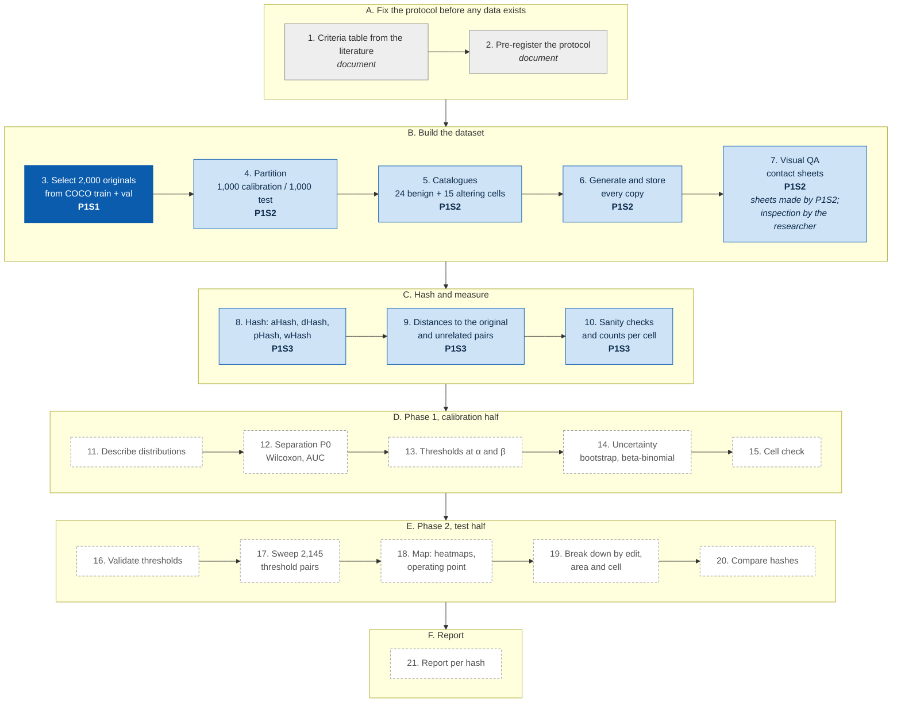

# P1S1 Dataset Generator

Step 3 of the Distance-vs-Accuracy experiment: download the COCO 2017 images that meet the protocol's
selection rules, from the terminal.

    python3 -m venv .venv && source .venv/bin/activate
    python3 -m pip install -r requirements.txt     # pinned versions, CPython 3.12
    python3 generate_dataset.py                 # asks for each setting; Enter keeps the default
    python3 generate_dataset.py -n 500 -s 400 -o ~/COCOSubset      # no questions
    python3 generate_dataset.py --help

The full experiment protocol — research questions, the 21 steps, the catalogues, the analysis and the
reproducibility rules — lives in [`protocol_v3.md`](protocol_v3.md). This README documents only the P1S1
script (step 3); the protocol is the single source of truth for everything else.

## Where this script sits in the experiment

P1S1 carries out step 3: it selects the 2,000 originals that the later steps copy, hash and analyse.
Each script reads only the output of the script before it.

**Dark blue:** this repository (P1S1 · P1S1_COCO_Dataset_Retriever), protocol step 3. **Light blue:** the
other published scripts (P1S2 · P1S2_Copy_Generator, steps 4–7; P1S3 · P1S3_Hash_Distances, steps 8–10).
**Grey:** protocol documents, not scripts. **Dashed:** scripts not written yet. Step 7 is partly automated:
P1S2 draws the contact sheets and the researcher inspects them.

## Usage

Settings: number of images (`-n`), minimum short side in px (`-s`), COCO pool (`--split val|train|trainval`;
`val` has 5,000 images and is enough for a few hundred; `train` and `trainval` need the much larger train
annotation file and ask for confirmation unless `-y`), seed (`--seed`), output folder (`-o`, must have no
images yet). The first run downloads the COCO annotation zip (about 250 MB) into `OUT/annotations/`; later
runs reuse it. Ctrl+C cancels cleanly and keeps the images already saved, with their labels.

The protocol's pool is train2017 + val2017:

    python3 generate_dataset.py -n 2000 --split trainval -o ~/COCOProtocol -y

Rules (protocol section 5): short side >= the chosen minimum; at least one non-crowd object whose filled
outline covers 1-20% of the image; EXIF orientation 1; each image once (by COCO id and by pixel content).

Output: `OUT/images/*.jpg` (original bytes, untouched), `OUT/labels/*.txt` (YOLO segmentation),
`OUT/classes.txt`, `OUT/selection_log.csv` (why each image examined was kept or rejected, and its split),
`OUT/images_manifest.csv` (one row per saved image: order, id, split, size, licence id, URL, SHA-256 of the
saved bytes, SHA-1 of the decoded pixels), `OUT/run_metadata.json` (settings, result counts, SHA-256 of the
annotation files, of the output tables and of the two scripts, Python and package versions). The same seed
and settings give the same images.

Exit codes: 0 finished, 1 error or invalid settings, 130 cancelled.

Tests (no network): `python3 -m unittest discover -s tests -v`

Files: `dataset_core.py` (selection and download logic), `generate_dataset.py` (terminal interface),
`tests/test_core.py`, `tests/test_cli.py`.

## Author and license
Author: Jose Luis del Valle (joseluisdelvalle@gmail.com).
Open source under the MIT License; see the `LICENSE` file.
